# Sefirah

**Your web novels, fanfiction, manga and webtoons, directly in [KOReader](https://koreader.rocks/).**

Browse multiple sources, follow your favorite stories, download chapters and read offline. Export novels as **EPUB** and manga as **CBZ**, without a computer to prepare your reading.

> **Sefirah is a fork of [Mythos](https://github.com/unitreign/Mythos), created by unitreign**, distributed under the **GPL-3.0** license and modified by **thefoolwholovestheworld**.

## Screenshots

*The interface follows KOReader's language unless you select another language in the plugin settings. The screenshots below show the French interface. Some screenshots predate the latest versions, so appearance may differ slightly from the current plugin.*

Screenshots are grouped with the features they illustrate below: [library and discovery](#library-and-discovery), [novels and fanfiction](#novels-and-fanfiction), [manga and webtoons](#manga-manhwa-and-webtoons), [progress center](#progress-center), [settings](#interface-and-customization) and [sources](#sources).

## Features

### Library and discovery

| Personal library | Novel catalog |
| :---: | :---: |
| 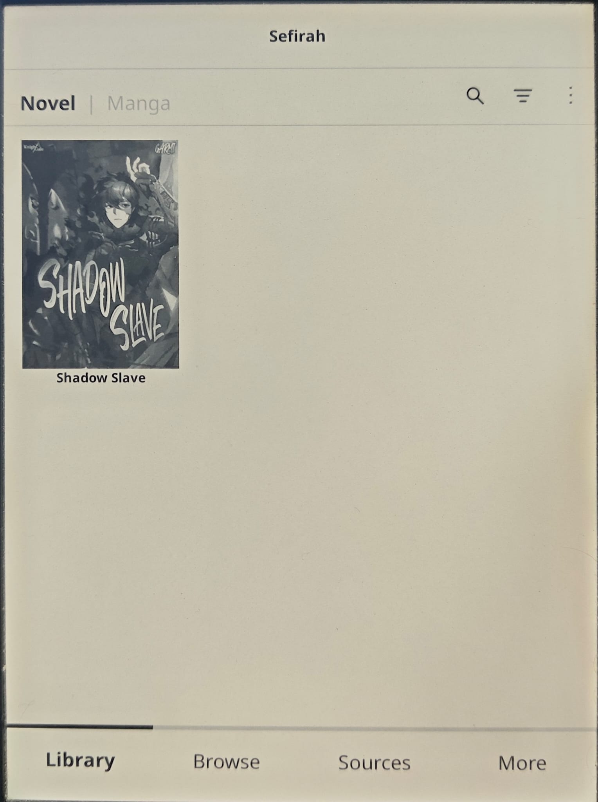 | 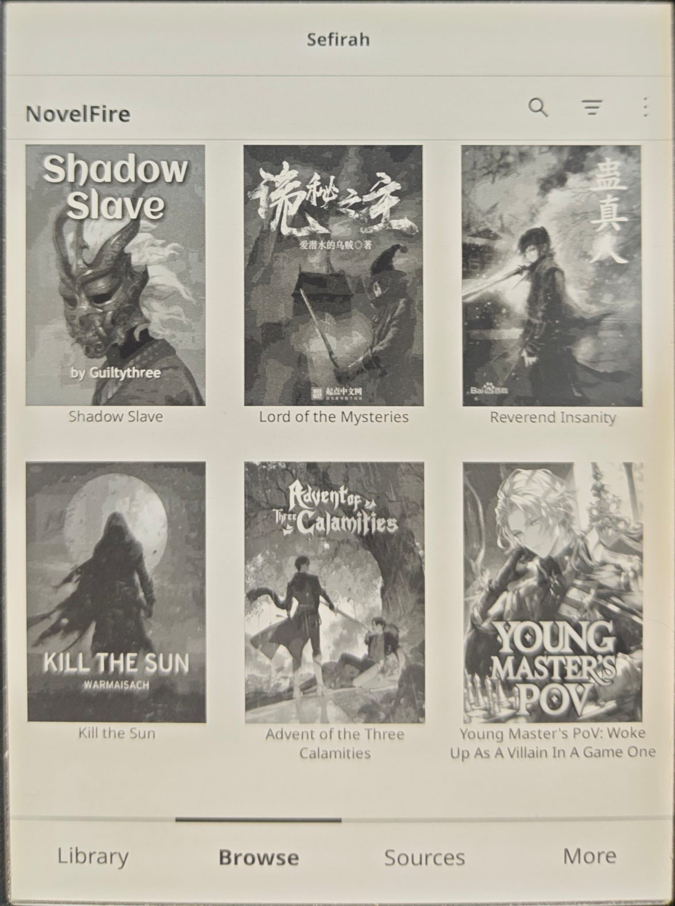 |

| Manga catalog | Manga search results |
| :---: | :---: |
| 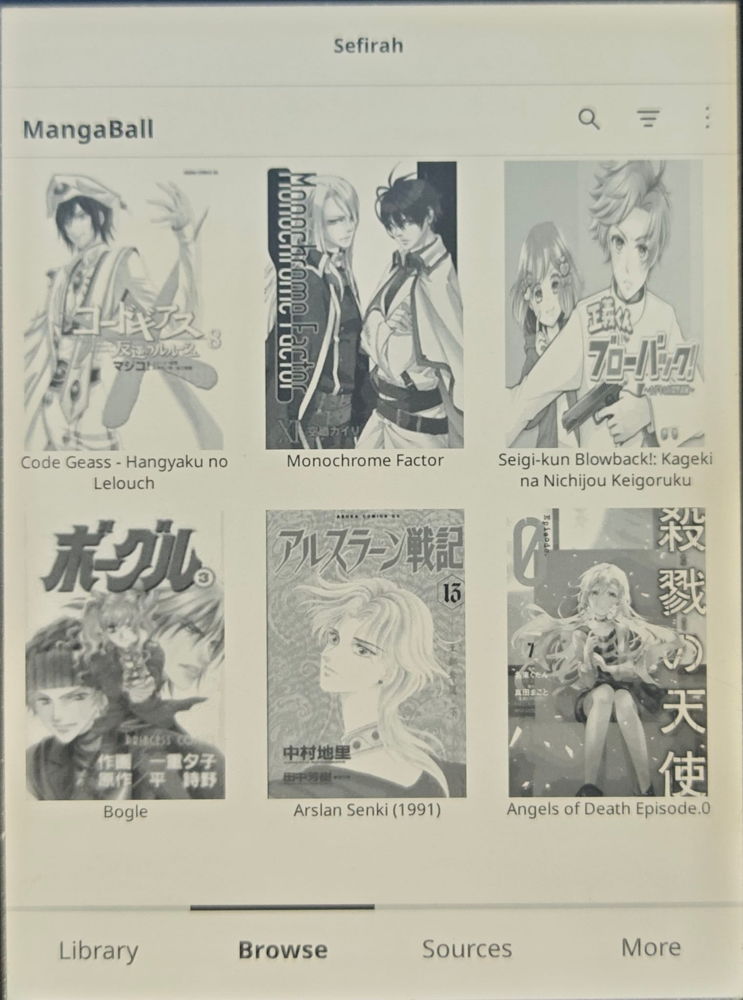 |  |

- **Four tabs:** Library, Browse, Sources and More.
- **Novels and manga:** switch between content types in the Library, Browse and Sources tabs.
- **Personal library:** keep track of followed titles and resume reading. Manga you read or download are added to the Manga tab automatically (this can be turned off in the settings).
- **Search and sorting:** alphabetical order, new chapters, recently added or recently read.
- **Release tracking:** refresh one title or your entire library to check for new chapters.
- **Global search** across installed sources.
- **Browsing filters**, depending on the source: genres, rankings, time periods and sorting.
- **Filters remembered per source**, with source filtering by language.
- **Sources installed on demand** from the Sources tab, using the online catalog of [Sefirah Source Hub](https://thefoolwholovestheworld.github.io/Sefirah-Source-Hub/).
- **Cached covers**, with separate options to disable them in the library, catalogs and title details.

### Novels and fanfiction

| Novel details | Chapter list | Reader reviews |
| :---: | :---: | :---: |
| 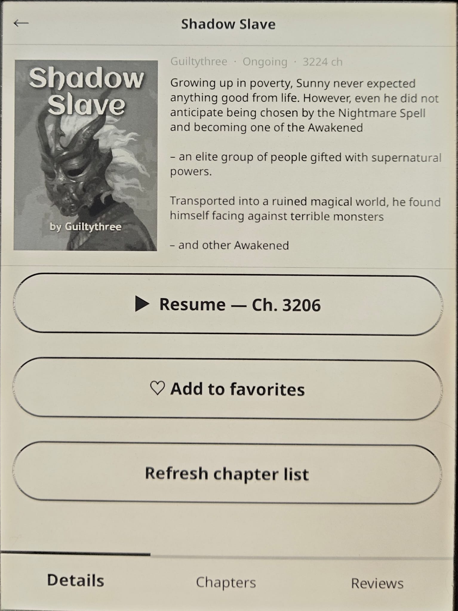 | 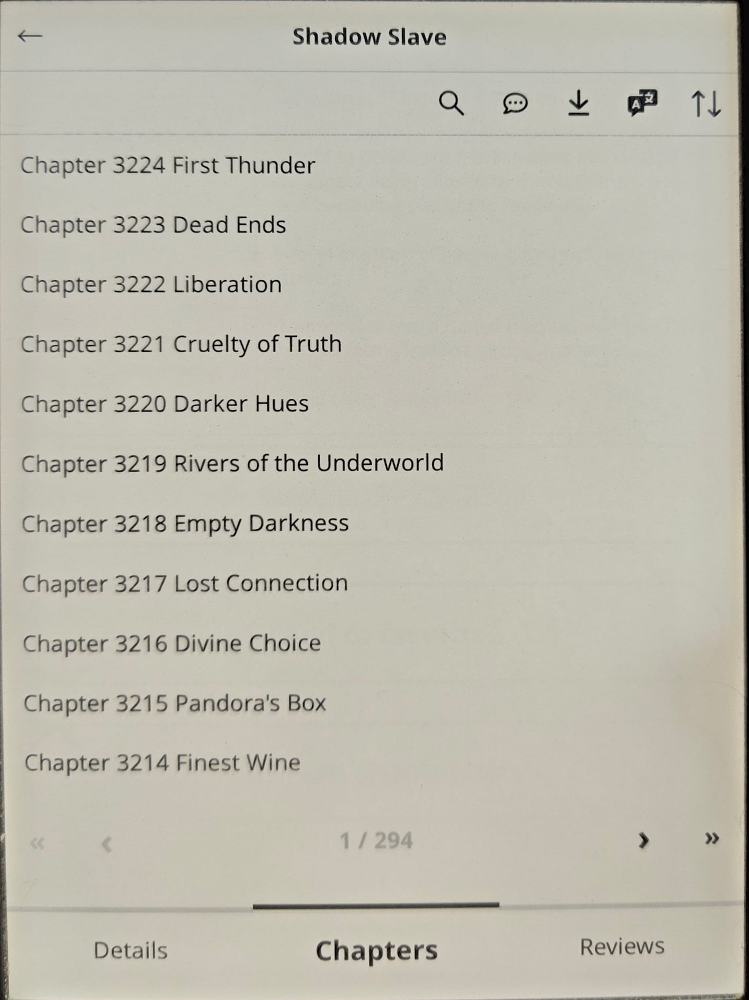 | 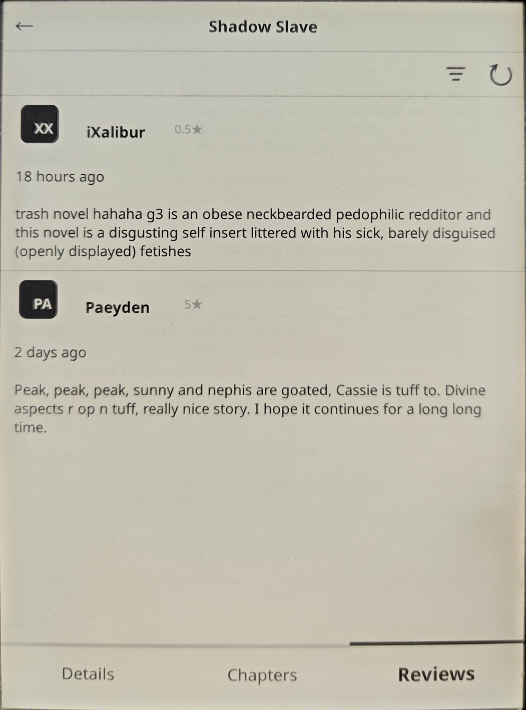 |

| Reading view | Reader controls | Reading preferences |
| :---: | :---: | :---: |
| 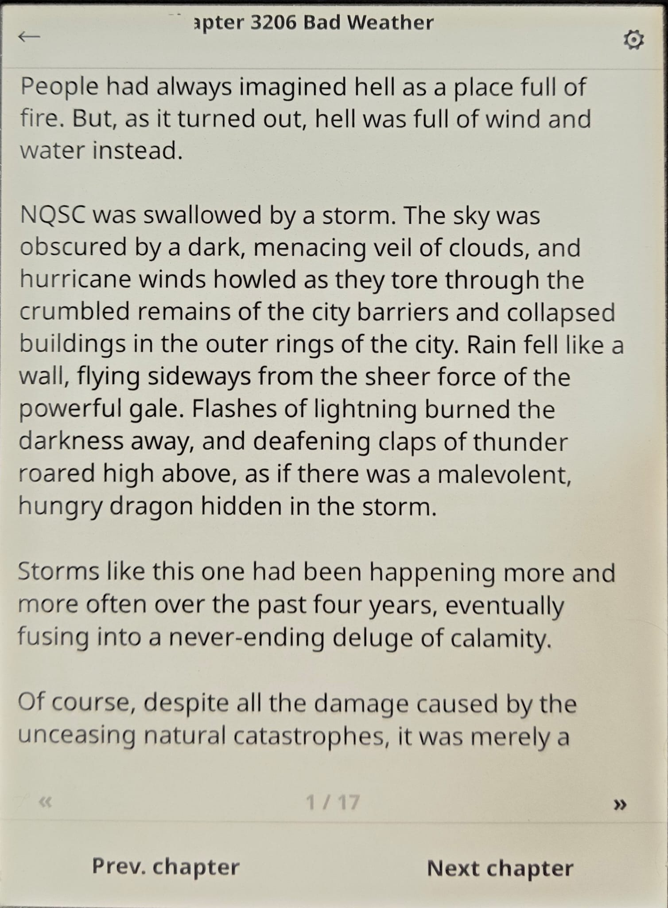 | 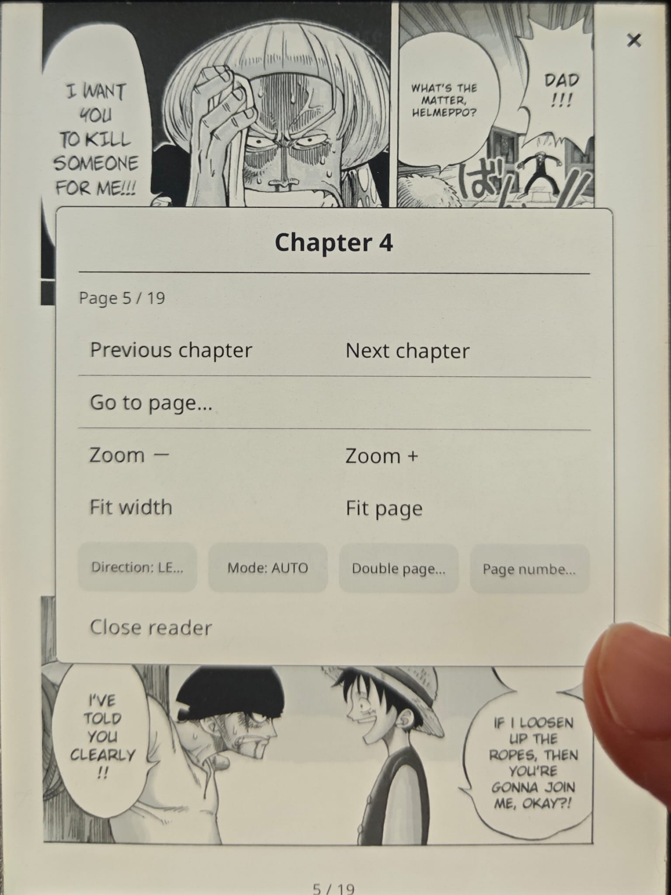 | 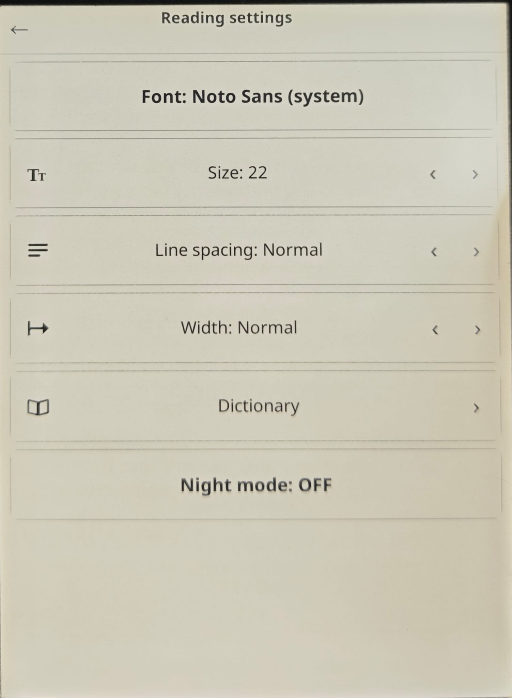 |

- **Title details** with cover, description, favorites and resume reading.
- **Chapter management:** search, jump to a chapter, and sort in ascending or descending order. The chapter list can open on the page of the chapter you are reading.
- **Built-in reader** with font selection, text size, line spacing and text width settings.
- **Optional chapter title:** hide the title bar text to give more room to the story. The back arrow and the settings gear stay available.
- **Large navigation buttons** in the reader, which can be turned off.
- **KOReader dictionary integration** while reading.
- **Previous and next chapter navigation**.
- **New chapter alerts**, per novel: when you add a novel to your favorites, Sefirah asks whether you want to be notified. Alerts can also be enabled for all novels or turned off in the settings. Each time the e-reader connects to Wi-Fi, notified novels are checked and a popup with the cover appears for each one that has new chapters, anywhere in KOReader.
- **Reading speed (words per minute)**, measured from the pages you actually read, and shown in the progress center. It can be turned off.
- **KOReader statistics:** reading time and pages in Sefirah's reader are also counted in KOReader's own Statistics screen.
- **Reviews and comments**, where supported by the source: title reviews, chapter comments and paragraph comments.
- **Optional offline comments.** Downloading comments can make chapter downloads slower.
- **Hide comments and reviews** by long-pressing the corresponding icon.

*Available features depend on the source.*

### Downloads and offline reading

- **Download chapters** to prepare your reading without an internet connection.
- **Persistent download queue**, retained after restarting KOReader.
- **Pause, resume and cancel** downloads.
- **Configurable automatic resume** after a network interruption or restart.
- **Download ahead while reading:** disabled, or 1, 3, 5 or 10 chapters ahead.
- **Configurable progress notifications**.
- The queue waits for the network to return **without turning Wi-Fi back on itself**.

### Chapter translation

Translate a chapter from the reader or the title details page into your chosen language.

| Engine | Setup |
| --- | --- |
| **DeepL** (API Free) | API key required |
| **Google Translate** | No API key required, but noticeably slower |
| **Gemini** | API key required |

*Availability, quotas and any charges depend on the provider. Text submitted for translation is sent to the selected service.*

### EPUB export

Export novels in the format that suits your reading:

- **One EPUB containing the selected chapters**.
- **One EPUB per chapter**.
- **Grouped volumes**.
- **A chapter range**.

Chapters are fetched before the EPUB is built.

**Synchronization with your KOReader library.** For an EPUB exported by Sefirah, your position is kept in sync in both directions: reading in Sefirah updates the EPUB's progress in the KOReader library, and the chapter you reach when reading the EPUB in KOReader is reported back to Sefirah. Sefirah only touches EPUB files it created itself and can match exactly with the chapters it exported.

### Manga, manhwa and webtoons

| Manga details | Manga chapters | Manga reader |
| :---: | :---: | :---: |
|  | 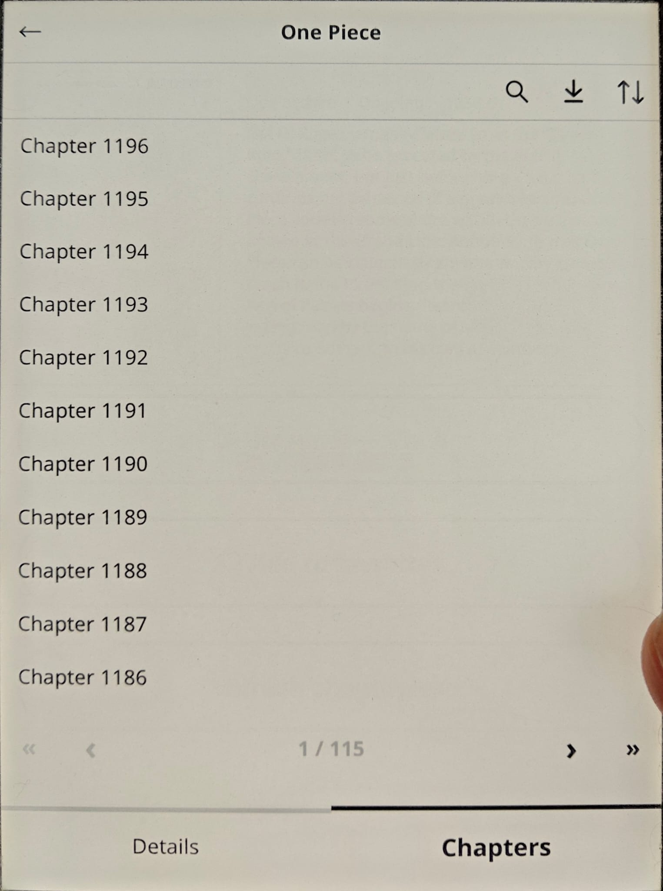 |  |

- Choose between **Sefirah's built-in reader** and **KOReader's native reader**.
- **Configurable reading direction:** automatic, left to right or right to left.
- **Manga and manhwa modes** for traditional pages and long vertical images.
- **Long pages split into screen-sized sections**.
- **Optional rotation of double-page spreads**.
- **Page number display** and automatic navigation to the next chapter.
- **Next chapter preloading**, which can be disabled.
- **Parallel image downloads**.
- **Configurable image quality:** original or compressed.
- **Automatic library entry** for manga you read or download, which can be turned off.
- **Storage management:** space limit, delete after reading, cleanup by title or remove all downloads.
- **CBZ export** for offline reading.

### Progress center

| Progress overview | Quest log | Achievements |
| :---: | :---: | :---: |
| 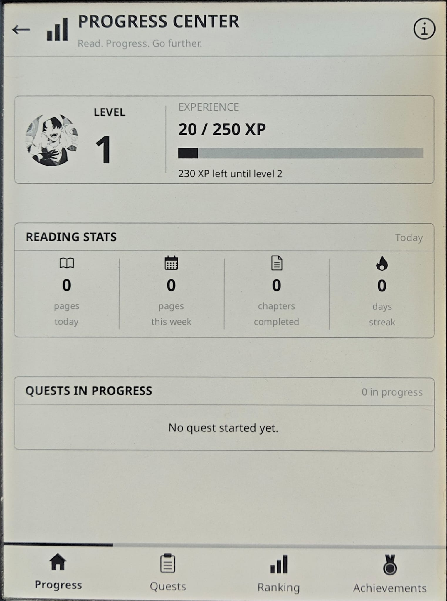 | 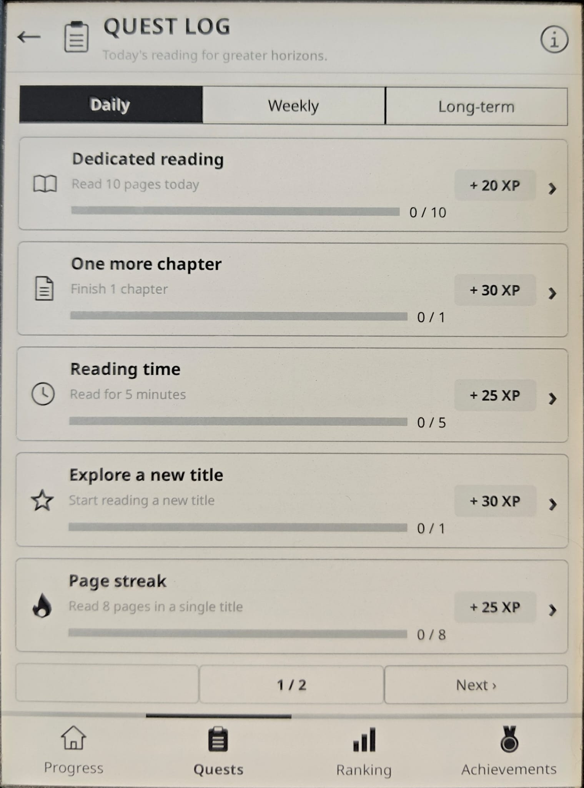 | 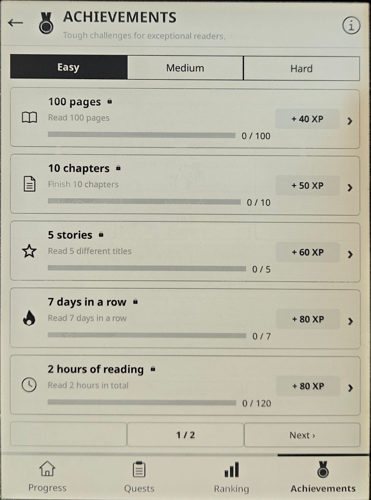 |

| Community leaderboard | Ranking categories |
| :---: | :---: |
| 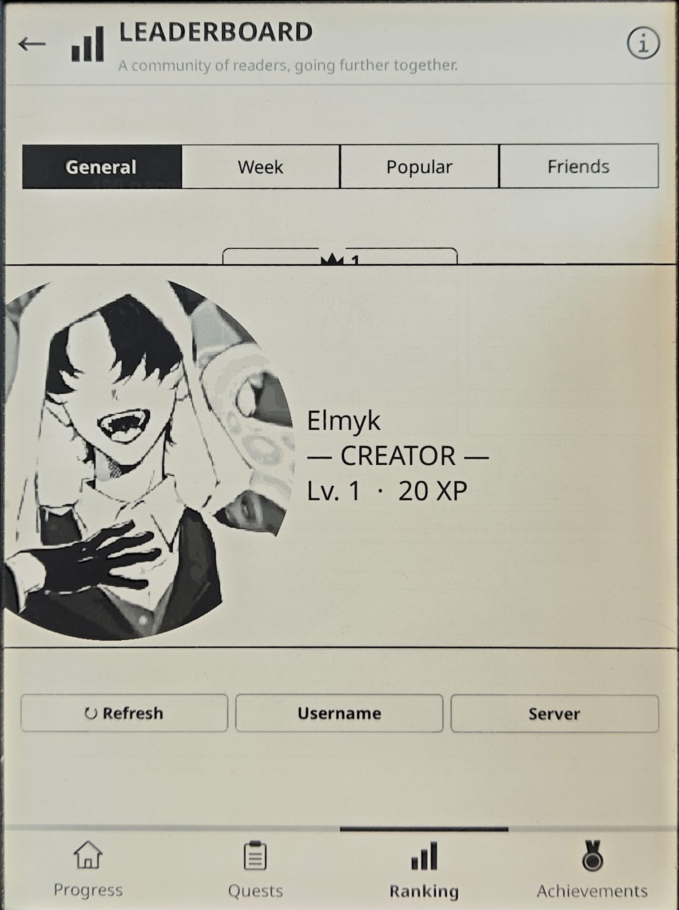 | 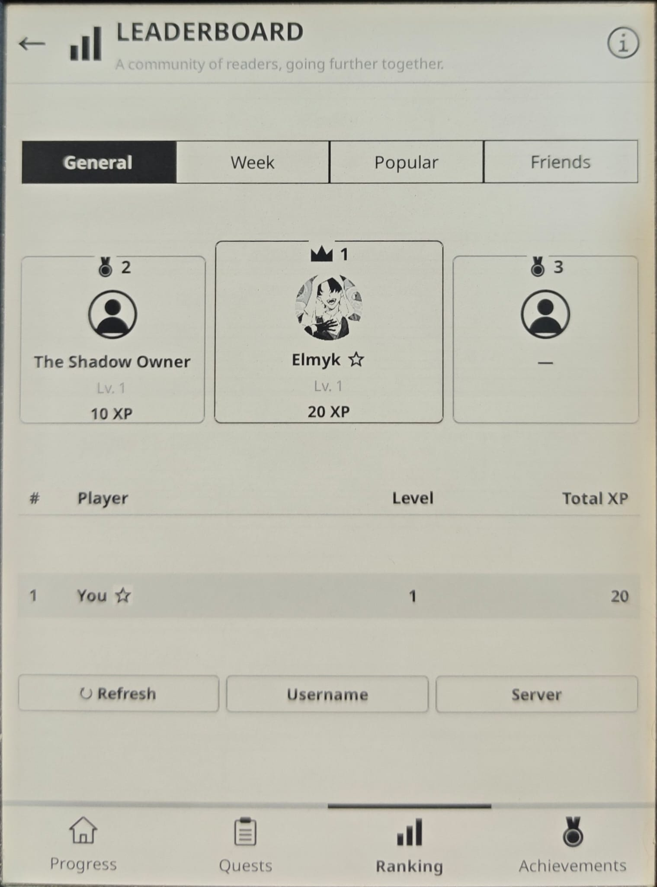 |

Track your reading activity in a dedicated space:

- **XP and levels**.
- **Daily, weekly and monthly quests**.
- **Achievements** organized by difficulty.
- **Pages, chapters and reading time tracking**.
- **Reading speed** in words per minute.
- **Reading streaks**.
- **Optional community leaderboard**, where your stats (pages read, chapters, streak, words per minute) are visible in the ranking and in a friend's menu.
- **Friends and profile picture**.
- **Help screen** explaining levels and ways to earn XP.

Local progress and quests are managed on the device. Community features require an internet connection and the configured leaderboard service.

### Interface and customization

  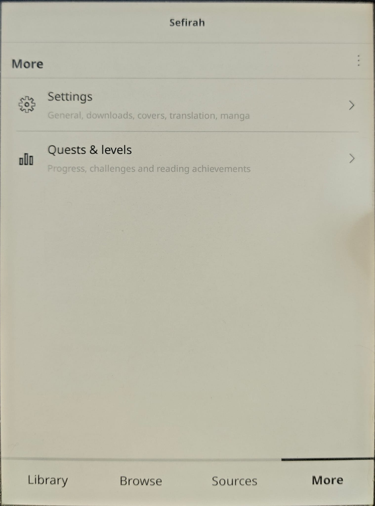
   <em>Plugin settings and customization options.</em>

- **Night mode** throughout the plugin.
- **17 interface languages:** Arabic, Chinese (Simplified and Traditional), Dutch, English, French, German, Indonesian, Italian, Japanese, Korean, Polish, Portuguese (Brazil and Portugal), Russian, Spanish and Turkish.
- **Automatic language selection** based on KOReader, or manual selection.
- **Settings organized by category**, including general, downloads, covers, translation and manga.
- **Reset progression statistics** without deleting your library or downloads.

## Sources

**Sefirah does not include any source.** Sources are small Lua files downloaded on demand from the online catalog of [Sefirah Source Hub](https://thefoolwholovestheworld.github.io/Sefirah-Source-Hub/). This keeps the plugin light, and sources can be fixed or added without a new plugin release.

| Source selection | Novel extensions | Manga and webtoon extensions |
| :---: | :---: | :---: |
| 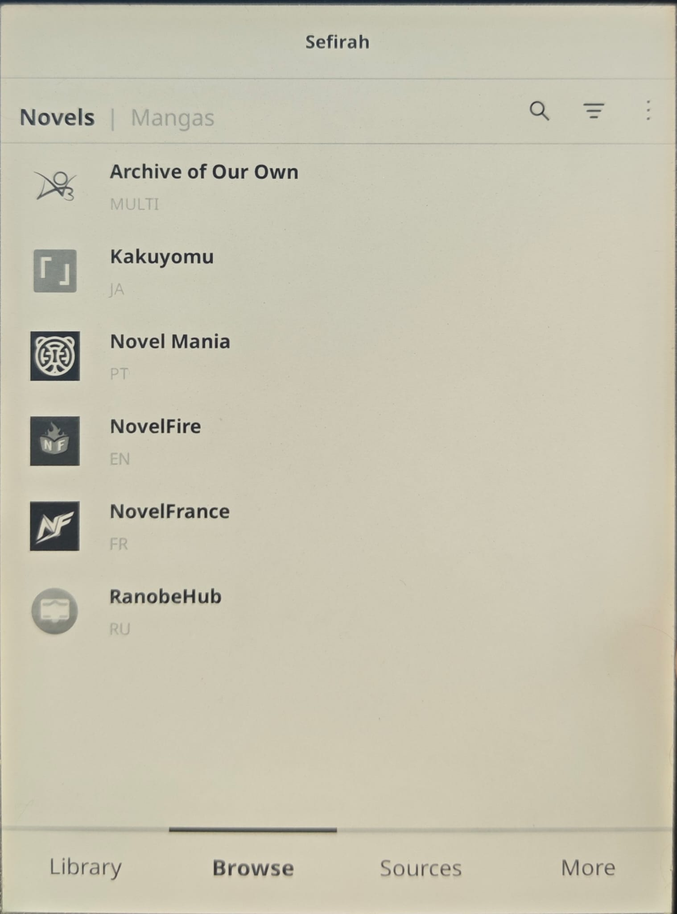 | 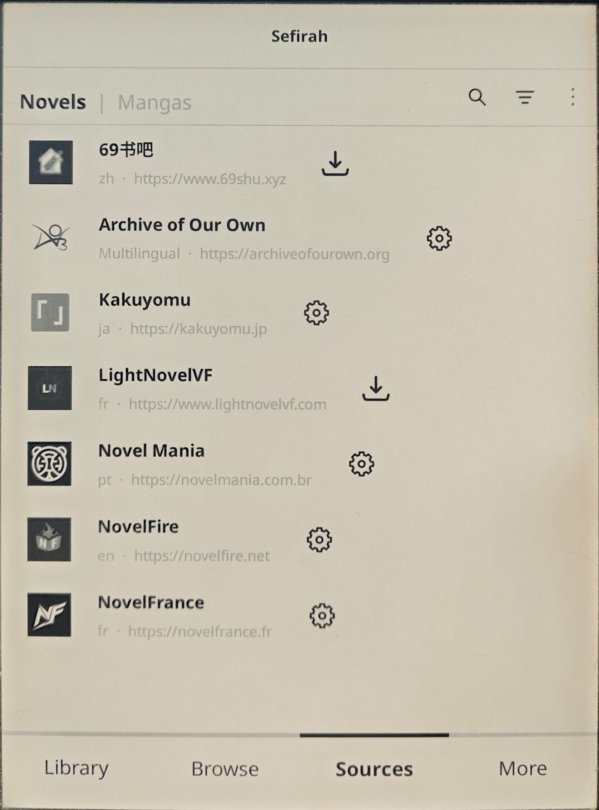 | 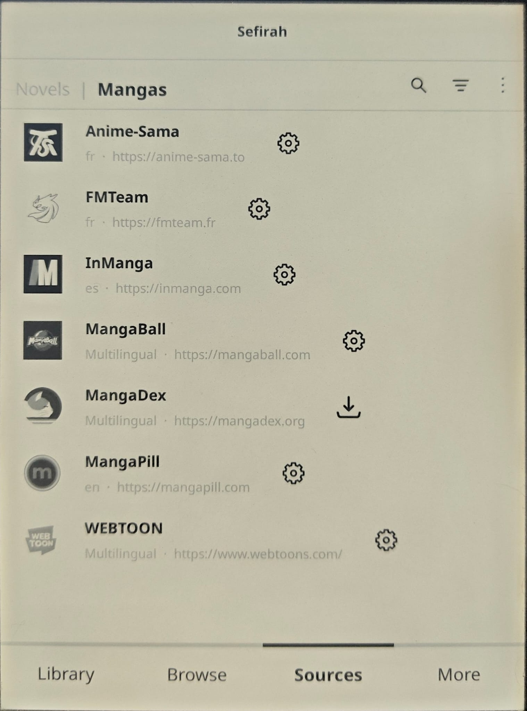 |

### Installing and managing sources

1. Connect your e-reader to Wi-Fi and open the **Sources** tab.
2. Tap the **antenna icon** and choose **Refresh the catalog**.
3. Tap the **install icon** next to a source to download and install it. It then appears in **Browse**.
4. When a newer version exists, an **Update** button appears in the source's settings.
5. **Delete the source** removes its file. A source from the catalog can be downloaded again at any time.

You can also **receive a source with a code**: create or test a source on Sefirah Source Hub, which shows a 4-digit code valid for a few minutes, then choose **Receive with a code** in the antenna menu and enter it. No cable and no restart needed.

Sources already installed on your e-reader keep working if you update the plugin. Sources you had installed are restored automatically when the catalog is refreshed, if a plugin update removed them.

### Available sources

The catalog evolves, so the list below is a snapshot and the Sources tab is the reference. Languages are those of the source's content.

#### Novels and fanfiction

| Source | Language |
| --- | --- |
| 69书吧 — 69shu | Chinese |
| Ar Novel | Arabic |
| Archive of Our Own — AO3 | Multiple |
| Azora Moon | Arabic |
| Beast Novels | English |
| Blume-Verse | English |
| Cenele | Arabic |
| Ixdzs8 | Chinese |
| Kakuyomu | Japanese |
| LightNovelVF | French |
| Linovelib | Chinese |
| LNCrawler | Multiple |
| MyDramaNovel | English |
| Novel Mania | Portuguese |
| NovelFire | English |
| NovelFrance | French |
| NovelFull | English |
| NovelNinja | English |
| RanobeHub | Russian |
| ReadNovel | English |
| Rewayahfans | Arabic |
| Royal Road | English |
| SeaNovel | Arabic |
| SkyNovels | Spanish |
| TruyenDichAI | Vietnamese |
| Wattpad | Multiple |
| Wordrain | English |
| WuxiaWorld.site | English |

#### Manga and webtoons

| Source | Language |
| --- | --- |
| Anime-Sama | French |
| FMTeam | French |
| InManga | Spanish |
| MangaBall | Multiple |
| MangaDex | Multiple |
| MangaPill | English |
| WEBTOON | Multiple |

### Source availability and limitations

Websites may change their structure, limit requests or use protections that are incompatible with the plugin. **A source being listed does not guarantee uninterrupted access or access to its entire catalog.**

Languages, filters, reviews and comments vary by source. Sefirah does not guarantee access to content requiring authentication, a subscription or an official app.

Use sources and download features in accordance with authors' rights and platform terms.

## Installation

1. Download the plugin archive from the [latest release](https://github.com/thefoolwholovestheworld/sefirah.koplugin/releases/latest).
2. Close KOReader.
3. Extract the archive into KOReader's `plugins` directory.
4. Make sure `main.lua` is directly inside `plugins/sefirah.koplugin/`, with no extra nested folder.
5. Restart KOReader.
6. Open **Sefirah** from the **Tools** menu.
7. Connect to Wi-Fi, open **Sources**, refresh the catalog and install your preferred sources.
8. Open **Browse**, select a title and add it to your library.

## Updating

1. Close KOReader.
2. Back up your Sefirah data as a precaution.
3. Replace the `sefirah.koplugin` folder with the one from the new release.
4. Restart KOReader.
5. Open **Sources** and refresh the catalog if some sources are missing or have an **Update** button.

Settings and library data are stored in KOReader's settings directory, separately from the plugin code. **Do not delete this data when updating.**

## Troubleshooting

### Sefirah does not open

- Make sure KOReader was closed while copying the files.
- Check that the archive was fully extracted.
- Make sure the plugin folder does not contain another nested `sefirah.koplugin` folder.
- Copy the complete plugin folder again if an error mentions missing files.
- If Sefirah no longer opens after your e-reader went to sleep, update to version 1.6.1 or later, which fixes this.

If the plugin fails to open, diagnostic information may be written to **`sefirah/last_open_error.txt`** inside KOReader's settings directory, as well as **`crash.log`**.

### No source is available, or a source is missing

- Sources are not bundled with the plugin: connect to Wi-Fi, open **Sources** and choose **Refresh the catalog** from the antenna menu.
- If the catalog does not load, check your connection and try again later.

### A source stops working

- Check your connection.
- Try again later: the website may be temporarily unavailable.
- Make sure you are using a recent version of Sefirah, and that the source is up to date (**Update** button in the source's settings).
- Check any **`*_last_error.txt`** files generated for the source.

When reporting an issue, include:

- Your KOReader and Sefirah versions.
- Your e-reader model.
- The affected source and its version.
- Steps to reproduce the problem.
- The error message or relevant log, **with API keys and other private information removed**.

Report bugs and source issues through [GitHub Issues](https://github.com/thefoolwholovestheworld/sefirah.koplugin/issues).

## Translations and contributions

The reference strings in the code are written in **French**. Translation files are located in **`locales/`**.

### Fixing a translation

1. Open the file for the relevant language.
2. Edit only the **translated values**.
3. Do not change the **French keys**.
4. Submit your changes in a pull request.

### Adding a language

1. Copy `locales/en.lua`.
2. Rename the copy using the appropriate language code.
3. Translate the values while keeping the keys unchanged.
4. Add the language to the selector in `ui/settings_dialog.lua`.

Some translations are machine-generated and may need proofreading.

### Adding or fixing a source

Sources are created, tested and shared with [Sefirah Source Hub](https://thefoolwholovestheworld.github.io/Sefirah-Source-Hub/), a web app that generates a source from a site's address and tests it. Source files and the catalog live in the [Sefirah-Source-Hub](https://github.com/thefoolwholovestheworld/Sefirah-Source-Hub) repository.

Contributions are also welcome for bug fixes, source maintenance and documentation improvements.

## Credits and license

**Original project:** [Mythos](https://github.com/unitreign/Mythos), by **unitreign**.  
**Fork and modifications:** **thefoolwholovestheworld**.

Sefirah is distributed under the **GPL-3.0** license, like the original project.

See [LICENSE](LICENSE) and [NOTICE.md](NOTICE.md) for licensing and attribution details.
